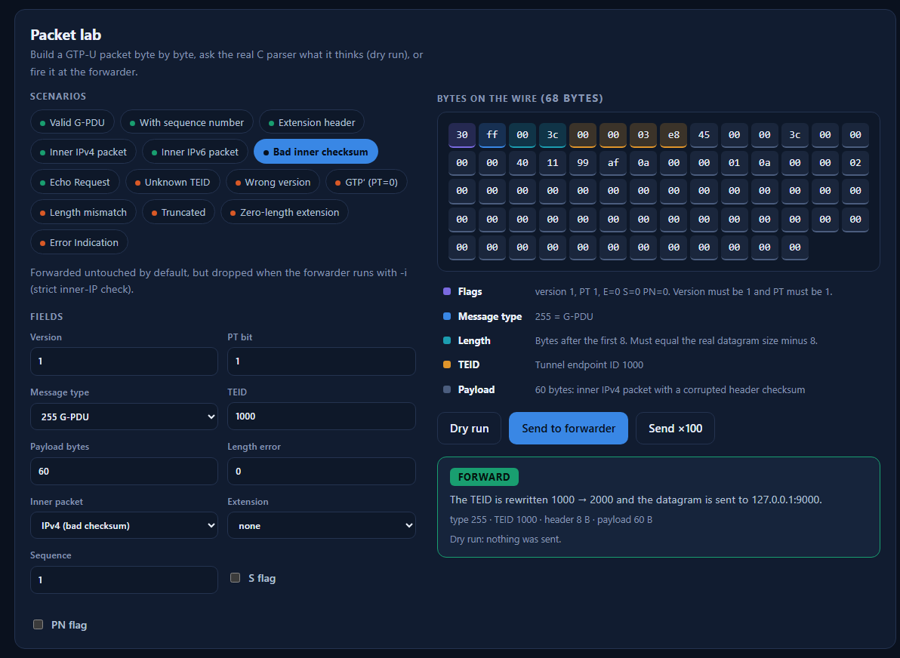

# gtpu-fwd

[](https://github.com/abhinavannareddy/gtpu_forwarder/actions/workflows/ci.yml)


**A GTP-U user-plane forwarder in C, with a live web control room.**

`gtpu-fwd` models one hop of a 4G/5G packet core user plane. It receives GTP-U over UDP, validates the
header ([3GPP TS 29.281](https://www.etsi.org/deliver/etsi_ts/129200_129299/129281/)), looks up the tunnel
endpoint ID (TEID), rewrites it and relays the packet to the configured IPv4 or IPv6 next hop. Everything it
refuses is counted by reason, never silently lost.


## Highlights

| | |
|---|---|
| **Correct by construction** | Bounds-checked header parser with a deterministic fuzz loop; clean under AddressSanitizer, UBSan, ThreadSanitizer and Valgrind in CI |
| **Fast path** | `recvmmsg` batches of 32, O(1) TEID lookup, no heap allocation per packet |
| **Scales across cores** | `-w N` workers on `SO_REUSEPORT` sockets; packet order is preserved within a flow |
| **IPv4 and IPv6** | Listen on either (or dual-stack `::`), forward to either family |
| **Protocol complete enough to trust** | Echo Request/Response, optional Error Indication for unknown TEIDs, optional inner IPv4/IPv6 validation |
| **Operable** | JSON control socket with token authentication, runtime route add/delete, per-route counters |
| **Observable** | Web control room: live throughput, drop reasons, route table, packet lab, traffic generator |
| **Shippable** | Docker images, `docker compose`, hardened systemd unit, CI on every push |

## Quick start

```bash
make && make demo              # build, then open http://127.0.0.1:8765
docker compose up --build      # same thing in containers
```

Run the forwarder on its own:

```bash
make
./gtpu-fwd -r routes.example.conf -p 2152 -w 4 -c 9100 -s 5
```

Route file, one route per line (`in_teid out_teid next_hop`):

```
1000 2000 127.0.0.1:9000
1001 2001 [2001:db8::10]:2152
```

### Options

| Option | Meaning |
|---|---|
| `-r FILE` | route file (required) |
| `-b IP` | bind address, IPv4 or IPv6; default `0.0.0.0`; `::` is dual-stack |
| `-p PORT` | UDP port, default 2152 (the registered GTP-U port) |
| `-w N` | worker threads, default 1 (max 64) |
| `-i` | strict mode: drop G-PDUs whose inner IPv4/IPv6 header is invalid (checks version, header length, total length, IPv4 header checksum) |
| `-e` | answer G-PDUs for unknown TEIDs with a GTP-U Error Indication (needs a specific `-b`; rate limited per worker) |
| `-s SECS` | print statistics every N seconds; final totals are always printed on exit |
| `-c PORT`, `-C IP` | enable the control socket (default bind `127.0.0.1`) |
| `-t TOKEN` | require a token on control requests; also read from `GTPU_CTL_TOKEN` |
| `-V` | print the version |

What happens to each datagram:

| Input | Result |
|---|---|
| G-PDU (type 255), known TEID | TEID rewritten, sent to the route's next hop |
| G-PDU, unknown TEID | dropped (`no_route`); with `-e` an Error Indication goes back to the sender |
| G-PDU with an invalid inner IP header (`-i` only) | dropped (`bad_inner_ip`) |
| Echo Request (type 1) | Echo Response (type 2), sequence number copied |
| Wrong version, PT bit clear, length mismatch, truncated, bad extension chain | dropped, counted per reason |
| Any other message type | dropped (`unsupported_type`) |

## Control room

`make demo` starts a forwarder, four simulated next hops and background traffic, then serves the UI at
<http://127.0.0.1:8765>. To watch an existing forwarder instead:

```bash
./gtpu-fwd -r routes.example.conf -c 9100 -t secret &
python3 dashboard/server.py --ctl 127.0.0.1:9100 --ctl-token secret
```

| Panel | What it does |
|---|---|
| Live | packets/s received, forwarded and dropped over two minutes, with hover values and a table view |
| Why packets die | drop counters by reason, straight from the forwarder |
| Route table | per-route packets and bytes; add and delete routes at runtime, IPv4 or IPv6 |
| Packet lab | 14 scenarios (valid, inner IPv4/IPv6, extension header, wrong version, hostile extension chain, ...). **Dry run** asks the real C parser what it would do; **Send** fires the packet at the forwarder and decodes any reply |
| Traffic generator | adjustable rate and mix of valid, unknown-TEID, malformed and Echo packets |

The dashboard is Python standard library only and makes no external requests, so it works offline.



## Control protocol

One request per UDP datagram, one JSON reply. With a token configured, prefix every request with it:
`<token> <command>`.

| Command | Reply |
|---|---|
| `stats` | counters, uptime, worker count, active modes |
| `routes [offset] [limit]` | one page of the route table with per-route counters |
| `add <in> <out> <next_hop>` | add a route (`ipv4:port` or `[ipv6]:port`) |
| `del <in>` | remove a route |
| `inspect <hex>` | dry run: parse and route lookup only, counters untouched |

## Deployment

* **Docker:** `docker build -t gtpu-fwd .` (non-root user), `docker build -f Dockerfile.dashboard -t gtpu-dashboard .`
* **Compose:** `docker compose up --build`. Set `GTPU_CTL_TOKEN` in your environment to replace the demo token. Only the dashboard (on loopback) and the GTP-U port are published.
* **systemd:** `deploy/gtpu-fwd.service` runs the forwarder as a sandboxed, unprivileged service.

See [SECURITY.md](SECURITY.md) for the threat model of the control channel, and
[docs/ARCHITECTURE.md](docs/ARCHITECTURE.md) for the threading model and design decisions.

## Testing

```bash
make test        # C unit tests + pytest (forwarder, workers, control socket, dashboard API) + Node tests
make asan        # AddressSanitizer + UBSan
make tsan        # ThreadSanitizer: the multi-worker forwarder under load, race = test failure
make valgrind    # memory errors and leaks
```

Highlights: packet-lab scenarios are replayed against the real parser so the UI can never promise
a verdict the forwarder does not deliver; route churn runs while four workers forward traffic.
CI runs everything above plus both Docker builds on every push.

## Measurements

`make bench RATE=<packets per second>`: 200,000 packets of 128 bytes through loopback, with sender,
forwarder and receiver on the same machine, one worker, one flow.

Test machine: AMD Ryzen 7 7730U laptop, Windows 11 with WSL2 (Ubuntu 24.04, 16 threads), gcc 13 `-O2`.
Your numbers will differ; run it on your own hardware.

| Offered rate | Received | Loss | Latency p50 | Latency p99 |
|---|---|---|---|---|
| 20,000 pps | 200,000 | 0% | 150 us | 3.0 ms |
| 50,000 pps | 190,119 | 4.9% | 321 us | 14.3 ms |
| 70,000 pps | 153,548 | 23% | 6.6 ms | 14.6 ms |
| unthrottled (~88,000 pps offered) | 122,089 | 39% | 6.8 ms | 14.8 ms |

Reading the table: on this virtualised loopback the forwarder is loss-free up to roughly 40,000 pps and
the loss above that happens *before* the forwarder (its `rx` equals its `forwarded` count): the kernel
receive buffer overflows. This is a single flow, so `-w` cannot help here; it spreads *different* flows
(distinct source ports) across workers. Loopback numbers say nothing about real network performance.

## Project layout

```
src/gtpu.[ch]       header parsing, TEID rewrite, Echo Response, Error Indication, inner-IP check
src/routes.[ch]     open-addressing hash table, IPv4/IPv6 next hops, file loader
src/ctl.[ch]        control protocol (pure function, unit-testable without sockets)
src/stats.h         per-worker counters with atomic accessors
src/main.c          worker threads, control socket, signal handling
dashboard/          control room: server.py (stdlib HTTP/SSE API) and static/ (UI)
tools/              loadgen.c (C load generator), trafficgen.py
tests/              C unit tests, pytest integration tests, Node tests
deploy/             systemd unit, compose routes
docs/               architecture notes, screenshot
```

## Scope

Not a complete packet core: there is no GTP-C control plane, and no per-session state, charging or QoS.
The forwarder moves GTP-U packets between configured tunnels and tells you exactly what it did with each one.

## License

MIT. See [LICENSE](LICENSE).
