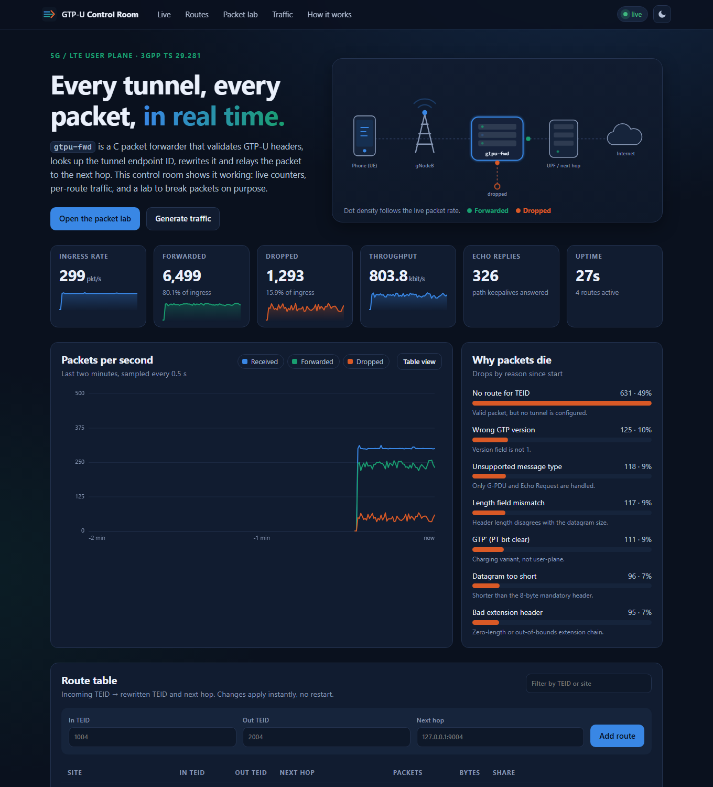

# gtpu-fwd - a GTP-U user-plane forwarder in C

A small Linux user-space packet forwarder that models one hop of a mobile
packet core **user plane**. It receives UDP datagrams, validates the GTP-U header
([3GPP TS 29.281](https://www.etsi.org/deliver/etsi_ts/129200_129299/129281/)),
looks up the tunnel endpoint ID (TEID) in a route table, rewrites the TEID and
forwards the packet to the configured next hop. Everything else is dropped and
counted by reason.

It ships with a **live web control room** (`make demo`): real-time throughput, drop reasons,
a route table you can edit without restarting, a packet lab that builds GTP-U packets byte by byte
and asks the real C parser for a verdict, and a traffic generator.

**Scope:** this is not a production packet core. It handles IPv4 only, has no GTP-C control plane,
and does not inspect the inner IP packet.

## Control room



```bash
make && make demo          # then open http://127.0.0.1:8765
docker compose up --build  # same UI, forwarder and dashboard in containers
```

| Panel | What it does |
|---|---|
| Live | packets/s (received, forwarded, dropped) over two minutes, with hover values and a table view |
| Why packets die | drop counters by reason, straight from the forwarder |
| Route table | per-route packets and bytes; add and delete routes at runtime |
| Packet lab | 11 scenarios (valid, extension header, wrong version, hostile extension chain, ...). **Dry run** asks the C parser what it would do, **Send** fires the packet at the forwarder |
| Traffic generator | adjustable rate and mix of valid, unknown-TEID, malformed and Echo packets |

The forwarder exposes this through a small UDP control socket (`-c PORT`, loopback by default).
Commands: `stats`, `routes [offset] [limit]`, `add <in> <out> <ip:port>`, `del <in>`,
`inspect <hex>` (dry run, no counters touched). Replies are JSON; see `src/ctl.h`.
The protocol is **unauthenticated**: keep it on loopback or a private network
(`docker-compose.yml` does not publish it). `dashboard/server.py` uses only the Python standard
library; the page makes no external requests.

## What it does

| Input | Result |
|---|---|
| G-PDU (type 255) with a known TEID | TEID rewritten, sent to the route's next hop |
| G-PDU with an unknown TEID | dropped (`drop_no_route`) |
| Echo Request (type 1) | Echo Response (type 2) sent back, sequence number copied |
| Wrong version, wrong protocol type, bad length, truncated, bad extension chain | dropped, counted per reason |
| Any other message type | dropped (`drop_unsupported_type`) |

Parser details: version and PT bit checks, length-field vs datagram size check,
optional header (E/S/PN flags) and a bounds-checked walk of the extension header chain
(zero-length extensions are rejected so a hostile packet cannot loop forever).

## Layout

```
src/gtpu.[ch]     header parsing, TEID rewrite, Echo Response builder
src/routes.[ch]   open-addressing hash table + route file loader
src/ctl.[ch]      control socket protocol (JSON), unit-testable without sockets
src/stats.h       counters shared by the data path and the control socket
src/main.c        poll + recvmmsg loop, statistics, signal handling
dashboard/        control room: server.py (stdlib HTTP/SSE API), static/ (UI)
tools/loadgen.c   fast C load generator and latency meter
tools/trafficgen.py   Python traffic generator (functional use)
tests/test_gtpu.c     unit tests incl. deterministic fuzz loop
tests/test_forwarder.py  pytest integration tests against the real binary
```

## Build and run

```bash
make                       # builds gtpu-fwd and loadgen (-Wall -Wextra -Werror)
./gtpu-fwd -r routes.example.conf -p 2152 -s 5
```

Route file (`in_teid out_teid ip:port`, one per line):

```
1000 2000 127.0.0.1:9000
```

Options: `-r routes` (required), `-b bind_ip`, `-p port` (default 2152), `-s stats_seconds`,
`-c ctl_port` and `-C ctl_ip` (control socket, off by default).
Statistics are printed on exit (Ctrl+C or SIGTERM).

Docker: `docker build -t gtpu-fwd . && docker run --rm -p 2152:2152/udp gtpu-fwd`

## Tests

```bash
make test        # C unit tests + pytest (forwarder, control socket, dashboard API) + node tests
make asan        # AddressSanitizer + UndefinedBehaviorSanitizer
make valgrind    # memory errors and leaks
```

CI (GitHub Actions) runs all of the above plus the Docker build on every push.

## Measurements

Command: `make bench RATE=<packets per second>` (200,000 packets, 128-byte payload,
loopback, one machine running forwarder, sender and receiver together).

Test machine for the numbers below: cloud sandbox, **2 vCPUs**, Linux, gcc 13 `-O2`.
Run it on your own machine and replace these numbers with yours.

| Offered rate | Received | Loss | Latency p50 | Latency p99 |
|---|---|---|---|---|
| 20,000 pps | 200,000 | 0% | 20 us | 2.2 ms |
| 50,000 pps | 200,000 | 0% | 19 us | 3.3 ms |
| 100,000 pps | 200,000 | 0% | 19 us | 7.9 ms |
| 150,000 pps | 200,000 | 0% | 57 us | 5.4 ms |
| 200,000 pps | 200,000 | 0% | 0.9 ms | 28.9 ms |
| unthrottled (~670,000 pps offered) | 95,787 | 52% | 26 ms | 36.7 ms |

Reading the table: the forwarder kept up without loss to about 200,000 packets per
second on this small shared machine. Above that the kernel socket buffer overflows and
packets are lost. The p99 latency is dominated by scheduling noise because the sender,
forwarder and receiver compete for the same two cores. Loopback numbers say nothing about
real network performance.

## Possible next steps

- Authentication or a Unix socket for the control channel
- Per-packet inner IPv4 header validation
- Multi-threaded workers with `SO_REUSEPORT`
- IPv6 next hops and GTP-U Error Indication messages
- A comparison against an eBPF/XDP fast path
